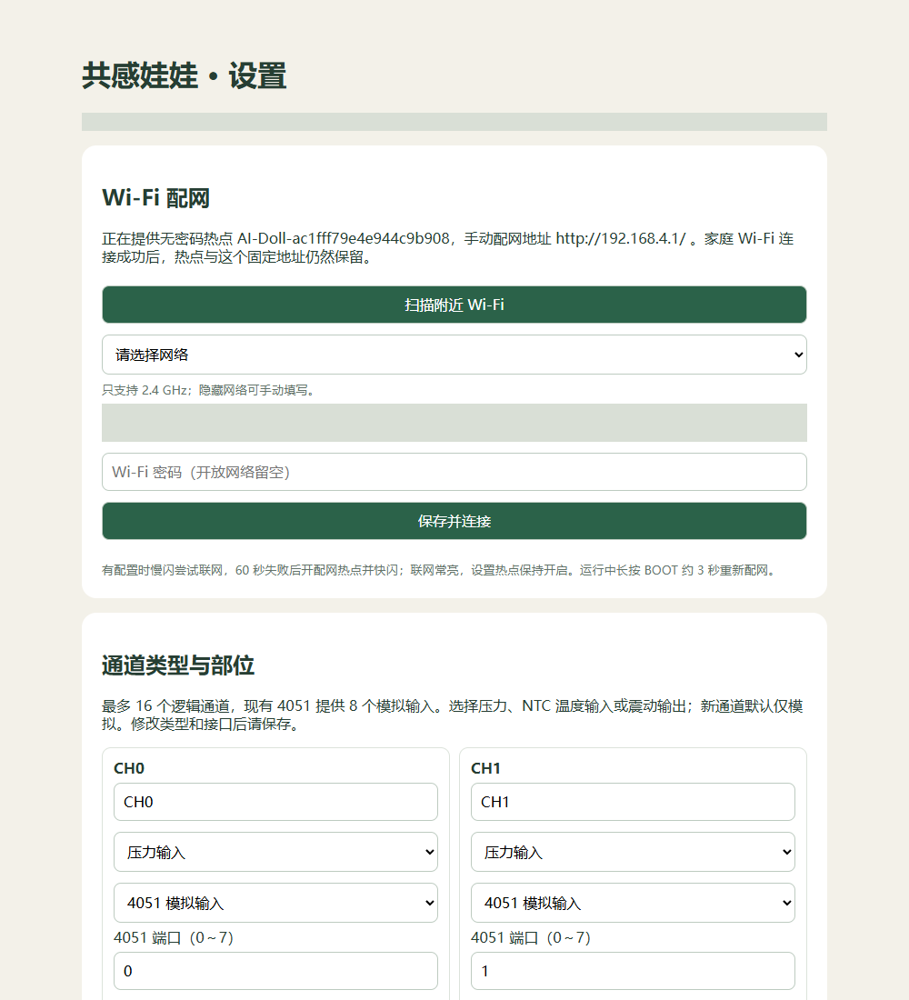

# 配家庭 Wi-Fi，并让电脑无线连接

> 按本页步骤操作即可；无需读完开发者资料。 [全部目录](../README.md)


先给娃娃供电。第一次用的新板还没有家庭 Wi-Fi；已经配过网也可以通过下面的固定入口修改。

## 一、手机给娃娃配网

1. 打开手机 Wi-Fi 列表，连接烧录成功页显示的 **AI-Doll-…** 热点。
2. 如果提示没有互联网，选择保持连接。
3. 在浏览器地址栏输入 **http://192.168.4.1/**。
4. 在“Wi-Fi 配网”点击扫描，选择家庭的 **2.4 GHz** 网络。
5. 填写家庭 Wi-Fi 密码，点击 **保存并连接**。不是填写娃娃网页的登录密码。
6. 等页面显示“已联网”，开发板灯常亮。



**配网成功后设置热点仍保留，固定地址始终是 http://192.168.4.1/。** 要再次设置，重新连娃娃热点即可，不用记家庭网络分配的 IP。

在家庭 Wi-Fi 中也能用设备实际 IP 打开设置页；该 IP 可能变化。`192.168.4.1` 只有连接娃娃热点时才能使用，不是家庭局域网中的固定 IP。

## 二、电脑与娃娃配对

电脑连接与娃娃可互通的家庭网络。在管理中心“设备连接”：

1. 用 USB 数据线把娃娃接到电脑，填写实际串口。
2. 点击 **一键识别并配对 Wi-Fi**。
3. 看到配对成功、连接方式 Wi-Fi、同步时间更新后，可拔掉 USB 数据连接。

也能在设备页复制实际 IP 和 MCP 令牌，到管理中心手动验证并保存。令牌只在自己的设备和电脑之间使用。

拔掉 USB 后仍要供电。主板外部供电用 5V / GND，J9 的 1 脚为 GND、2 脚为外部 5V；主板没有充电、升压或电池保护电路。板外电池模块按 [接线指南](SENSOR_CHANNELS.md)处理。

## 找回已配对设备

设备换了家庭 IP 时，在管理中心点击“查找已配对设备”。先确认供电和同一可互通局域网；访客网和客户端隔离可能阻止发现。

查找只识别已经配对的设备。**再次 USB 烧录后名称变了，需要重新识别/配对**，这不是普通 IP 变化。

## 切回 USB

在“设备连接”选择 USB 与当前串口，保存后检查设备状态。USB 与 Wi-Fi 电脑采集使用同一个历史库。Wi-Fi 失败不会自动改为 USB。

## 登录自动采集

默认不开启。需要时在“维护与诊断”设置当前用户登录后启动；这只启动本项目采集，不启动 AI，也不保证聊天自动回复。移动软件目录前关闭旧启动项，移动后再开启。

## 常见情况

| 现象 | 处理 |
| --- | --- |
| 手机总是跳回其他网络 | 选择保持连接娃娃热点，必要时暂时关闭自动切换 |
| 找不到家庭 Wi-Fi | 确认路由器提供 2.4 GHz，隐藏网络手动填写 |
| 配网完成但不知设置地址 | 连接娃娃热点，打开 192.168.4.1 |
| 电脑无线配对失败 | 检查电脑和娃娃网络是否互通；先用 USB 验证 |
| 再次烧录后旧配对失败 | 新名称是预期行为，用 USB 重新识别 |

<details><summary>维护人员：查找和启动项命令</summary>

在项目根目录执行。运行中的采集器优先通过页面修改，不同时直接改配置文件。

```powershell
.\python\python.exe tools/discover_device.py
.\python\python.exe tools/configure_startup.py install --dry-run
.\python\python.exe tools/configure_startup.py install
.\python\python.exe tools/configure_startup.py status
.\python\python.exe tools/configure_startup.py remove
```

发现使用 UDP 28768 和已配对身份挑战验证，不跨 VLAN，不自动首次配对。锁文件存在不表示服务仍在运行；不能靠删除锁文件启动第二个采集器。

</details>

断网缓存看 [离线记录](OFFLINE_RECORDS.md)，密码看 [登录说明](RUNTIME_AND_LOGIN.md)，仍有问题看 [故障排查](../TROUBLESHOOTING.md)。
