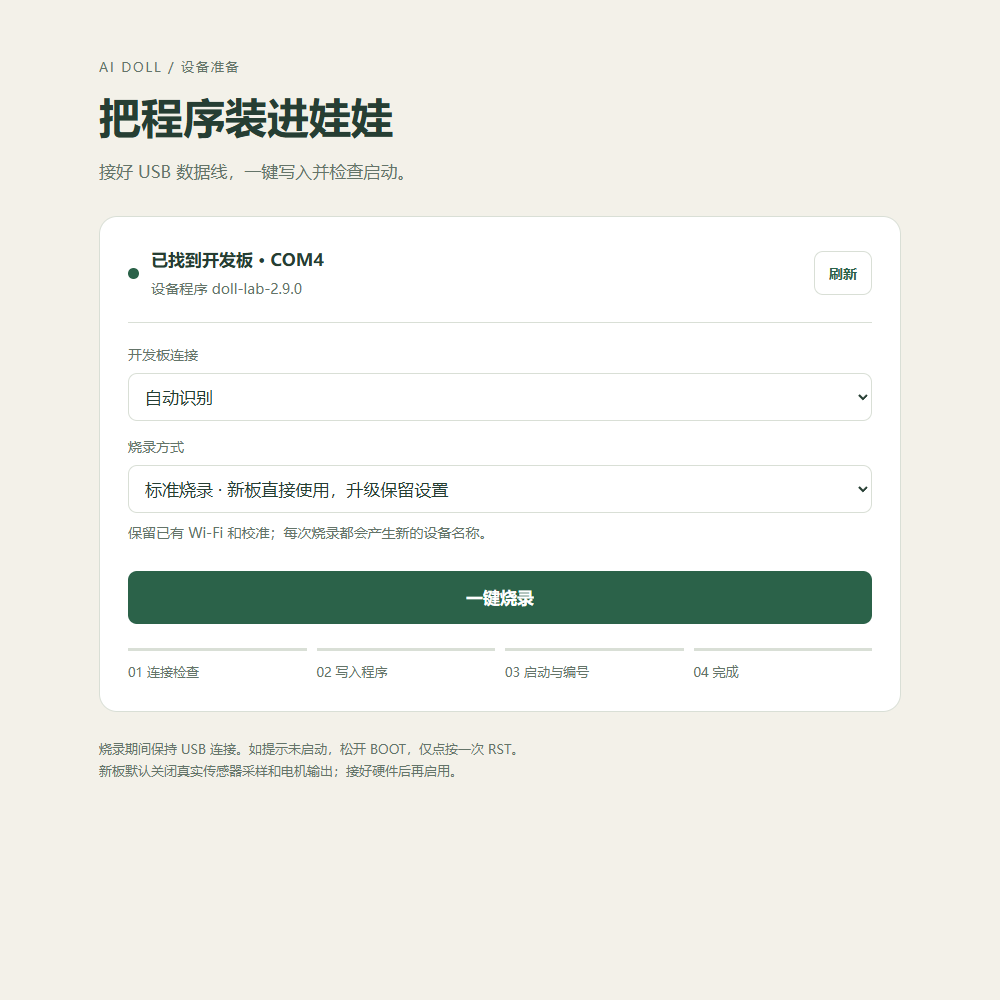
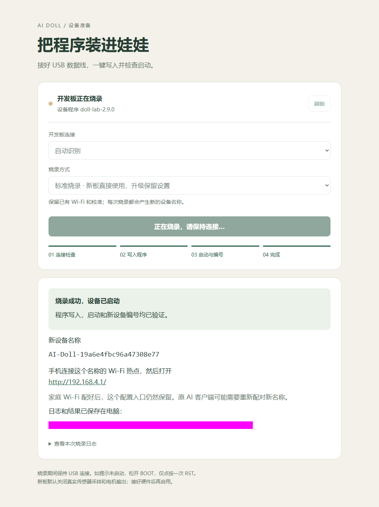

# 给开发板烧录：双击，一键完成

> 按本页步骤操作即可；无需读完开发者资料。 [全部目录](../README.md)


你需要：一块 ESP32-C3 SuperMini、一根能传数据的 USB 线、一台 Windows 64 位电脑。不需要安装 Arduino，也不需要自己编译。

## 1. 下载并解压

从 [下载入口](https://github.com/SunRichardSKT/ai-doll-mcp/blob/main/delivery/README.md)取得 **Windows 完整包**，完整解压到一个固定目录。不要直接在 ZIP 里双击，也不要只复制启动文件。

## 2. 接线并打开烧录页面

用 USB 数据线连接开发板，双击根目录 **Flash_ESP32.cmd**。浏览器自动打开电脑上的 `http://127.0.0.1:8770/`。

看到“已找到开发板”后，保留“标准烧录”，点击 **一键烧录**。只有一块开发板时，不用填写串口。



如果连接了多块板，先在“开发板连接”选择对应串口；不知道是哪块时，拔掉再插回，观察新增的那一项。

## 3. 等待成功

页面依次检查连接、写入程序、校验、启动和新设备编号。看到 **“烧录成功，设备已启动”** 才算完成。过程中保持 USB 连接。



每次成功的 USB 烧录都会得到新名称，例如 `AI-Doll-` 后跟 20 位编号。编号保存到板内，日常断电、重启不会改变；再次 USB 烧录才重新生成。原 AI 配对可能需要更新。

## 4. 找到设备设置页

手机连接成功页面显示的 `AI-Doll-…` Wi-Fi 热点，在浏览器地址栏输入 **http://192.168.4.1/**。这是娃娃的固定设置入口，家庭 Wi-Fi 配好后也保留。

手机提示“没有互联网”时，选择继续连接。这个热点用来设置娃娃；电脑的烧录页面和娃娃设置页面是两个地址。

## 自动连接失败怎么办

1. 关闭占用串口的其他烧录工具或串口监视器。
2. 按住开发板 **BOOT** 不松开，点按并松开 **RST**，最后松开 BOOT。
3. 回到页面点击刷新，重新选择串口，再点击烧录。
4. 如果写入完成但一直等启动，松开 BOOT，**只点按一次 RST**。

本项目自己的 USB 采集服务会暂时停止并在烧录后恢复；活跃互动会话不会被强行中断。失败不会自动连续擦写。

## 日志与出厂设置

每次尝试都有独立目录 `build/flash/日期时间-独立编号/`，保存 `flash.log` 和 `result.json`，失败也保留。页面可展开“查看本次烧录日志”。

标准烧录保留已有配网、通道、校准和板内缓存；全新板自动使用 [首次启动设置](FACTORY_SETTINGS.md)。只有你要清空设备时，才选择“恢复出厂”并勾选清除确认。电脑历史不会删除。

## Linux 或维护人员

以下在项目根目录执行；普通 Windows 用户跳过这一节。

```bash
python -m pip install -r requirements-flash.txt
python tools/flash_esp32.py --list-ports
python tools/flash_esp32.py --port /dev/ttyACM0
```

Windows 命令行仍可运行 `Flash_ESP32.cmd --check` 只验证镜像，或 `Flash_ESP32.cmd --port COM4` 烧录指定板。`--factory` 明确清空设备。源码构建见 [开发指南](../developers/DEVELOPER_GUIDE.md)。

下一步：[配网与电脑连接](../daily/WIFI_CONNECTION.md)，再按 [压力校准](../daily/CALIBRATION_AND_DAILY_MODE.md)检查实体传感器。烧录成功本身不证明传感器或电机正常。
