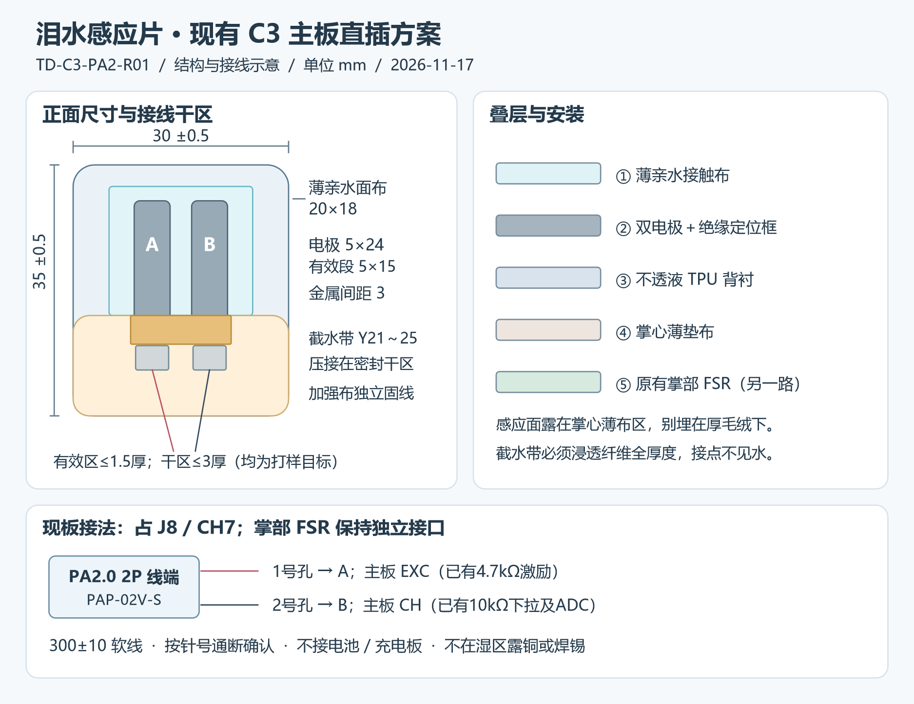

# 泪水感应片：第一代 C3 直插量产设计 R01

采用**双电极软质湿润片＋PA2.0 2P 线束**，插入第一代主板现有传感器口。装在娃娃掌部表层，感知擦拭时接触的液体。固件 0.1.5 支持独立触发，也可与另一接口上的掌部 FSR 联动。

R01 为供应商打样规格。尺寸、材料、装配与检验项目已定义；湿滴灵敏度、晾干时间、接点寿命及批间一致性通过下面的首件和小批试制确定，再签封样量产。产品检测的是湿润接触，不识别液体来源。

## 交付文件

| 文件 | 用途 |
| --- | --- |
| [结构与接线图](assembly.svg) | 感应片尺寸、层次、接线和拉线保护 |
| [1:1 裁切与定位图](cut-patterns.svg) | A4、单位 mm；按 100% 打印，先核对 20mm 标尺。图中电极是原料裁片，不能与成品定位图混用 |
| [材料与询价表](bom.csv) | 单只用量、材料要求、供应商报价栏 |
| [检验项目](inspection.csv) | 全检、抽检及打样放行条件 |
| [样品记录表](sample-record.csv) | 实填干湿读数、复位时间和重复测试结果 |
| [通道设置说明](../../../../docs/daily/SENSOR_CHANNELS.md) | 当前软件的设置入口 |

设计编号：**TD-C3-PA2-R01**。线束默认 300±10mm，可按娃娃尺寸另定长度；长度变化作为新物料后缀记录，不混批。



## 1. 结构定型

成品外形 **30×35mm，圆角 R3**；上部为接触区，下部为密封接线区。感应区目标厚度不超过 1.5mm，接线区目标不超过 3mm，均不含 PA 插头。靠布袋或周边缝位安装，不让胶贴和毛绒遮住感应面。

以正面左上角为坐标原点，X 向右、Y 向下，尺寸单位 mm：

| 项目 | R01 标称值 | 要求 |
| --- | --- | --- |
| 成品外轮廓 | X=0～30，Y=0～35，R3 | 长宽 ±0.5 |
| 电极 A | X=8.5～13.5，Y=5～29 | 5×24，圆角 R0.8；非裸金属箔 |
| 电极 B | X=16.5～21.5，Y=5～29 | 与 A 同材、同方向、同批 |
| 两电极金属边缘间隔 | 3.0 | 定位后 2.5～3.5，任何弯曲／按压状态不接触 |
| 有效电极段 | Y=5～20 | 两条各 5×15；边缘包覆后每条有效宽度至少 4 |
| 上层吸液薄布 | X=5～25，Y=3～21 | 20×18；固定在非导电区，保持中间导水通路 |
| 隔离定位框 | 30×35，R3；两窗口 4×15 | 窗口 X=9～13、17～21，Y=5～20；PET/TPU 非导电材料；金属间距 3mm，窗口间距 4mm |
| 截水封装带 | Y=21～25，贯穿两条电极全宽 | 浸润电极纤维全厚度，截断沿纤维进入接点的毛细通道 |
| 压接位置 | Y=25～29，两电极各一处 | 全部藏入 Y=21～35 干区；无尖角外露 |
| 线尾固定 | Y=29～34，软线居中向下出线 | 绝缘导线固定于加强布，拉力不经过电极压接处 |
| 缝合边 | 两侧 X=0～3、27～30 | 只缝绝缘边，不穿电极、压接件、截水带 |

由外到内：**薄亲水面布 → 双电极及绝缘定位框 → 不透液 TPU 背衬 → 娃娃布袋／软垫**。FSR 安装在背衬后的另一层，隔一层柔软垫布，不与电极并接。普通长毛绒会阻挡小水滴接触，应在掌心留出薄布接触区。

### 电极、接点与固定

- 电极指定 **316L 不锈钢导电织物**，优先 100% 金属纤维织物；厚度目标 0.15～0.35mm。供应商提供材质和规格，不以仅含少量导电纤维的防静电布替代。切边用绝缘框包住，不露散丝。
- 每条电极的线束端至有效段最远处，含接点的电阻目标 **≤20Ω**。纤维编织方向、压接宽度和压力在首件后锁定。
- 用适配导电织物的双翼压接片，将织物折叠夹紧并与线束连接，分别封在柔性绝缘胶中。普通 PA 压接端子只用于插头端，不能代替织物接点夹片。
- 不锈钢织物不按普通铜线方法直接上锡；若供应商改用电阻焊等工艺，应重做接触电阻和拉力检查。湿区不露铜线、焊锡或压接件。
- 截水带和接点封装使用非导电、柔性、可浸润纤维的封装材料；先做相容性、固化和毛细渗水样品。热熔胶只可用于外围固定，不能代替截水封装。
- 接线区加 30×14mm 非导电加强布、独立固线回路，出线外侧留约 10mm 松弯；不做细小悬空卡扣。PA 插头留在娃娃内部可维护位置。

这是局部防潮结构，不声明整片或整机防水。感应片拆下后按维护要求局部清洁，不连同电池、主板或插头浸洗。

## 2. 与现板直接连接

```text
主板 3.3V ─ 已有 4.7kΩ ─ J8.1 / EXC ─ 电极 A
                                             ⋮ 液体导通
主板 GPIO0 ADC ← 74HC4051 ← J8.2 / CH7 ─ 电极 B
                                   │
                              已有 10kΩ
                                   │
                                  GND
```

线端使用 **PA2.0 2P，PAP-02V-S**，匹配板端 **S02B-PASK-2**。配套端子 **SPHD-002T-P0.5**，配 28AWG 多股镀锡铜软线、单线外径 0.8～1.0mm，并由线束厂确认所用端子和压接工具。端子线规及绝缘外径以 JST 手册为准；同名兼容件必须试配锁扣和退针。

| 连接 | 线束定义 |
| --- | --- |
| PA 插头 1 号孔位，对应主板 Jx.1 EXC | 电极 A，可用红色／编号 1 线 |
| PA 插头 2 号孔位，对应主板 Jx.2 CH | 电极 B，可用黑色／编号 2 线 |

**此口的两根线不是电源正负极。** 不接电池、不接充电板、不额外接 GND，也不接三线水位模块。按插座针号通断确认，不能凭插头照片左右或线色判断。感应片本身无极性，量产仍固定以上线序。

建议使用 **J8/CH7**。如需压力联动，可选择已接入的掌部压力通道，例如 CH0。只加湿润片最多为 **7 路压力＋1 路湿润**，再加 NTC 时为 **6 路压力＋温度＋湿润**。

标称电路下，感应片短路时电流约 **0.224mA**，ADC 节点约 **2.245V**；这是电路计算，不是整机安全或寿命认证。湿区电阻为 47kΩ / 100kΩ / 1MΩ 时，节点电压约为 0.535 / 0.288 / 0.0325V。它帮助检查接线，不能线性换算为 C3 的 ADC 原始刻度。

## 3. 现有软件怎么用

0.1.2 起支持 `wetness`，下面的设置步骤对应 0.1.5。

1. 断电后把感应片插入 J8。使用联动时，掌部 FSR 接独立接口。
2. 在“传感器端口”找到 J8 · CH7，类型选择“擦眼泪感应片”，填写位置名称。
3. 在“湿润片触发方式”选择“仅湿润触发”，或选择要联动的压力部位。0.1.4 通过高级参数中的 `pressure_channel` 指定压力通道。
4. 初始参数 `wet_threshold=500`、`dry_threshold=250`、`hold_ms=600`、`dry_ms=1000`；再按样品读数调整。将该路设为“已接入”，点“保存此端口”。
5. 湿润持续达到 600ms 后记录 `wet`。满足设置的触发条件后产生一次 `wipe`。同一湿润阶段只触发一次，干燥持续 1000ms 后复位并记录 `dry`。
6. 默认只记录。需要聊天回应时，再允许擦眼泪回复、绑定聊天并开启已有主动回复设置；官方 MCP 客户端能否主动发起还取决于宿主能力。

湿润读数使用 **12 位原始 ADC**，不是压力校准后的量程、百分比或毫伏。当前采样约每 20ms 一轮，切换 4051 后丢弃首读并平均 4 次采样。参考 PDF 的 GPIO4 接线、50ms 计数和单一 500 阈值属于其示例，不照搬到本板；本板 GPIO4 是多路选择线。

### 阈值封样方法

首批所有样品，在实际掌心布层、线长和供电条件下采集：干燥静置及干燥按压各 30 秒，湿润后稳定读数 10 秒。记全批最坏干读数 Dmax 和最坏湿读数 Wmin。排除达到稳定前的浸润过程，但单独记录首次达到湿阈值的时间。

- 首轮统一参数目标：**Dmax≤150，Wmin≥1000**，有余量使用 500/250；这是待样品验证的验收目标。
- 若不能满足，先查接点、金属散丝、布料吸液和装配；不要靠逐只调阈值掩盖工艺差异。
- 若整批一致偏移且 `Wmin-Dmax≥300`，可用 `dry_threshold=Dmax+0.25×差值`、`wet_threshold=Dmax+0.60×差值` 向最近整数取整，满足 0≤dry<wet≤4095；在重复使用及实际布层测试通过后，作为新的整批参数封样。
- 干燥后出现长期偏高，先清除盐渍并彻底晾干；不能把实际未干通过缩短 `dry_ms` 强制复位。

## 4. 批量装配流程

1. **来料与清洁**：核对导电织物批次和方向、绝缘布吸水性、软线、PA 物料。湿接触材料无导电胶残留和金属碎屑。
2. **裁切**：按 1:1 图模切织物、面布、TPU 背衬与绝缘框。切边不掉金属丝；首批可用定位治具手工裁切，封样后转刀模。
3. **定位**：将两条电极固定在背衬上，用 3mm 定位治具检查间距；绝缘框包住边缘。用非导电固定工艺，胶不堵住有效湿区。
4. **连接与截水**：在干区完成两处织物压接，逐一测到电极的电阻；浸润并固化截水带、独立接点密封，湿区与压接区之间不能有沿织物贯通的毛细通道。
5. **面布与固线**：装 20×18mm 薄面布，四边固定在绝缘边，不把两电极缝在一起。安装线尾加强布和机械固线，再合上干区绝缘盖层。
6. **线束与全检**：PA 端压接、插壳、核对 1/2 号孔位。做外观、导通、干态和抽样拉力检查；湿检品与未湿检品分开标记。
7. **湿检与回干**：用规定体积滴液，不用手直接挤一团湿棉代替；湿检后用少量去离子水局部清洁感应面、吸去余水、充分晾干，再做回干检查才装袋。
8. **装袋追溯**：一只一袋，标物料编号、线长、材料批号、日期、统一参数版本；附简短接线和维护卡，不把插头放进湿区。

## 5. 检验与投产

[inspection.csv](inspection.csv) 中的数值是 R01 **工程目标**；首件通过后由供应商确认工装与工时。先做 **10 只首件**，再做 **50 只小批**；样品或小批不足以声明寿命和可靠性认证。

| 项目 | 方法 | R01 目标 |
| --- | --- | --- |
| 干态绝缘与挤压 | 23±5℃、40～65%RH 静置 24h；万用表低压电阻档，测 PA 两脚，平放及约 5N 软垫按压 | ≥1MΩ，无金属接触短路；记录实际湿度 |
| 湿滴与触发 | 在中央跨电极区域滴 50±5µL、0.9% NaCl 质量浓度水溶液；只用作可重复台架液。使用实际掌心面布 | 3 秒内达到湿阈值；随后连续 600ms 判湿；电阻目标≤47kΩ，最终以实际板 raw 为准 |
| 重复互动 | 真实掌部 FSR：先干按、再只滴液、再湿时按、重复按、彻底回干后再湿按 | 干按无 wipe；只湿无 wipe；湿按一次 wipe；同湿段不重复；回干后可再次触发 |
| 线尾拉力 | 固定绝缘加强区，沿出线方向 5N、10 秒，检查前后电阻与间距 | 不脱落、不露金属、不短路，单极导通仍≤20Ω；不是人体承重线 |
| 夹具导通 | 每条线脚到电极最远点，定压探针，在封面前检查 | ≤20Ω；针脚相互绝缘，锁扣和退针合格 |
| 反复湿干 | 每只 30 轮规定滴液、清洁和自然晾干；插在现板上观察漂移 | 无腐蚀露线、无脱层，仍满足同批阈值；记录每轮实际回干时间 |
| 滞湿与渗水 | 100µL 分两次、间隔 30 秒，竖放 10 分钟；背面及压接区放干吸水纸 | 无可见渗入背衬和接点；不据此声明浸泡／IP 防护 |
| 弯折与布层 | R≥10mm 弯折 200 次，实际装入娃娃后重复干湿检查 | 无散丝短路、断线和失效；满足同批阈值 |

50µL 不是最低检出量或“每滴眼泪”的保证。首件另外测 10、20、50µL，并记录在实际布层中能否导通，达不到的档位不作为宣传能力。实际汗、水和泪液的电导率不同，不以标准盐水通过推定所有液体都会有同样读数。

感应片自然回干受面布、环境和液量影响，首件目标记录是否能在 10 分钟内恢复同批干阈值；未达到时更换更薄、少蓄水的面布或做可替换接触片。`dry_ms=1000` 是读数已干后的确认时间，不代表湿布 1 秒晾干。长时间持续浸湿不作为本 R01 用途；现板持续直流激励的极化、腐蚀和残留漂移由重复湿干样品检验，不以选择不锈钢替代寿命验证。

### 供应商询价要求

按 **10 / 50 / 100 / 500 只**分别报：材料、线束、接点工艺、模切装配、逐只电检、湿检清洁回干、包装、税运，以及一次性刀模／治具费用。BOM 的价格栏留空等待实际报价，不将材料费当成成品出厂价。要求提供材料牌号、导通样品、压接剖面或工艺说明和截水带样品；禁止未确认就替换为铜镍镀层布、单纯防静电布或直接焊锡接不锈钢。

首件通过后签封样：感应布型号及面密度、导电织物厚度/方向、每层尺寸、压接和封装工艺、线长、统一阈值、清洁和晾干方法。任一关键材料改变，重做干湿窗口、拉力和渗水检查。

## 6. 用户安装卡

**断电 → 感应片 PA2.0 插 J8 → 感应面朝掌心表面 → 固定线尾 → CH7 设为“擦眼泪感应片”，选择触发方式。**

感应片可轻触面颊的湿润处，避开眼球，会按设置触发一次互动。用后取下清洁、晾干，再次使用前确认状态已恢复“干”。拔插时按锁扣并拉插头，别拽导线。保持核心、电池、充电板和接线区干燥。

## 依据与许可

- 用户提供的《泪水检测 & 发抖检测：原理与实现》：参考湿润分压、持续判定、按压关联和一次性事件思路。本交付仅设计湿润感应，不实现发抖模块。
- [现板制作与拓扑](../resistive-inputs/README.md)、[最终主板接口](../../pcb/candidates/c3-socket-20261105/README.md)、[当前湿润驱动](../../../../firmware/src/resistive_inputs.h)、[通道配置与能力](../../../../firmware/src/channel_devices.h)。
- [JST PA 原厂手册](https://www.jst-mfg.com/product/pdf/eng/ePA-F.pdf)：PA 系列、线壳、端子线规和绝缘外径，特别是第 2、6 页；量产以采购型号最新手册为准。
- [Bekaert 导电纤维与纱线](https://www.bekaert.com/en/products/basic-materials/textile/e-textiles-/conductive-fibers-and-yarns-for-smart-textiles)：说明不锈钢导电纺织材料的工艺可行性，不代表厂家已验证本 R01 或提供医疗/皮肤接触认证。
- [Atlas Scientific 电导测量原理](https://files.atlas-scientific.com/EC_K_1.0_probe.pdf)：液体电导与电极的基础参考；其 AC 探头不是本板的供电方式。

硬件结构、裁切图与制造文件使用 **CERN-OHL-S-2.0**，许可见 [hardware/LICENSE](../../../LICENSE) 与 [LICENSING.md](../../../../LICENSING.md)。本方案继续使用项目 AGPL-3.0-only 软件，不包含参考文档原件或第三方图纸副本。
