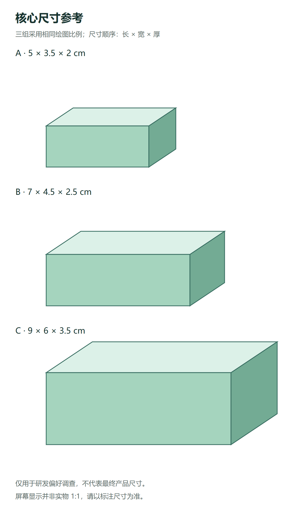

# 共感娃娃核心二代研发意向调查

我们正在规划共感娃娃核心二代，希望了解你真正需要的功能，以及能够接受的体积、供电和连接方式。本次调查用于确定研发优先级，所列功能均为候选方向，不代表最终产品承诺，也不涉及预订或付款。预计填写约5分钟，欢迎按实际需求选择。

## 使用与体积

### 1. 你目前与共感娃娃的关系是？

题型：单选题，必填。

- 正在使用一代
- 购买过但尚未开始使用
- 了解过但未购买
- 第一次了解

### 2. 你计划安装核心的娃娃，大约多高？

题型：单选题，必填。

- 不足20cm
- 20～30cm
- 31～40cm
- 41～60cm
- 超过60cm
- 尚未确定

### 3. 你主要会在哪里使用？

题型：多选题，必填，最多3项。

- 家中日常陪伴
- 床边或睡前
- 书桌、办公桌
- 随身携带外出
- 展示或拍摄
- 移动机器人或底盘
- 其他

### 4. 你更希望核心安装在哪里？

题型：单选题，必填。

- 娃娃身体内部
- 头部内部
- 放在娃娃外面，通过线连接
- 均可
- 需要看最终结构

### 5. 你能接受的核心外壳最大尺寸大约是？

题型：单选题，必填。

尺寸顺序为长×宽×厚。请参考同一比例的尺寸示意图；这些尺寸仅用于偏好调查，不代表最终产品尺寸。

- 5×3.5×2cm
- 7×4.5×2.5cm
- 9×6×3.5cm
- 可以更大
- 仅看数字难以判断

### 6. 如果功能、续航和体积不能全部兼顾，你最优先考虑什么？

题型：单选题，必填。

- 尽量小巧
- 续航更长
- 功能更丰富
- 价格更低
- 连接与使用更稳定

## 功能需求

### 7. 二代最值得优先加入哪些功能？

题型：多选题，必填，最多4项。

- 触摸感应
- 听到我说话
- 播放AI语音回复
- 拍照给AI看
- 振动回应
- 舵机带动头部或肢体
- 温度感知
- 拿起、倾斜、摇晃感知
- 灯光反馈
- 轮式底盘移动
- 其他

### 8. 上述功能中，哪一项最影响你是否购买或升级？

题型：单选题，必填。

- 触摸感应
- 听到我说话
- 播放AI语音回复
- 拍照给AI看
- 振动回应
- 舵机带动头部或肢体
- 温度感知
- 拿起、倾斜、摇晃感知
- 灯光反馈
- 轮式底盘移动
- 其他
- 暂时没有决定

### 9. 你希望通过什么方式开始互动？

题型：多选题，必填，最多3项。

- 触摸娃娃
- 对娃娃说唤醒词
- 按实体按钮
- 手机里点击或发消息
- 由传感器事件自动触发
- 其他

### 10. 你预计需要多少个独立触摸部位？

题型：单选题，必填。

- 1～2个
- 3～4个
- 5～8个
- 9～12个
- 超过12个
- 不确定

### 11. 对语音互动，你希望达到什么程度？

题型：单选题，必填。

- 暂时不需要
- 娃娃能播放回复即可
- 按住按钮说话、松开后回复
- 说唤醒词后轮流对话
- 希望自然对话，并能打断它
- 不确定

### 12. 对摄像头，你倾向怎样使用？

题型：单选题，必填。

摄像头属于后续候选模块。

- 不需要
- 可选购，需要时再安装
- 愿意安装，但仅在我主动操作时拍照
- 希望经我开启后持续提供画面
- 尚未决定

## 供电与连接

### 13. 你最希望采用什么供电方式？

题型：单选题，必填。

- 内置充电电池
- USB插电
- 外接充电宝
- 可拆换电池
- 都可以

### 14. 如果使用电池，一次充电至少使用多久你才满意？

题型：单选题，必填。

按平时联网、间歇互动的使用习惯回答。

- 2小时
- 4小时
- 8小时
- 12小时
- 24小时或以上
- 主要插电使用

### 15. 你目前主要使用哪些AI聊天应用？

题型：多选题，必填。

- Operit
- ChatGPT
- SillyTavern或酒馆类
- 其他手机AI应用
- 自己部署的聊天前端
- 目前还没使用
- 其他

### 16. 你更希望设备通过什么方式连接？

题型：多选题，必填，最多2项。

这些是需求选项，实际支持方式尚未确定。

- 蓝牙连接手机
- 连接家庭Wi-Fi
- 连接手机热点
- USB连接电脑
- 不确定，希望设置简单即可

### 17. 你能接受哪些设备在使用时保持运行？

题型：多选题，必填。

- 仅手机
- 自己的电脑
- 自己的服务器
- 希望设备能够直接联网工作
- 暂不确定

### 18. 对模块安装，你能接受到什么程度？

题型：单选题，必填。

- 插上就能用
- 插线后按手机向导配置
- 愿意自行组装、烧录或焊接
- 希望购买安装好的整机，尽量不接触内部模块

## 预算与联系

### 19. 你对基础核心本体的最高可接受价格大约是多少元？

题型：简短填空，选填。

可填写金额或“不确定”。包含核心、外壳和电池，不含娃娃、外接传感器套装，以及摄像头、音频、动作、底盘等选配模块；此处仅调查预算，不是报价。

### 20. 你最希望二代解决什么问题，或者还有哪些建议？

题型：多行填空，选填。

一代用户可以填写现有问题，未使用过的用户可以填写最担心的使用障碍。

### 21. 是否愿意参与后续研发访谈或内测？

题型：单选题，必填。

- 愿意参与需求访谈
- 愿意参与内测
- 两者都愿意
- 本次只填写调查

### 22. 如愿意联系，请自愿留下一个联系方式。

题型：简短填空，选填。

微信、QQ或邮箱均可。仅用于共感娃娃核心二代的研发访谈或内测通知，不公开展示；不填写也可以提交问卷。

## 提交完成文案

感谢你的建议！我们会结合需求、体积、成本与稳定性确定研发顺序。若你自愿留下联系方式，后续可能邀请你参与访谈或内测。
